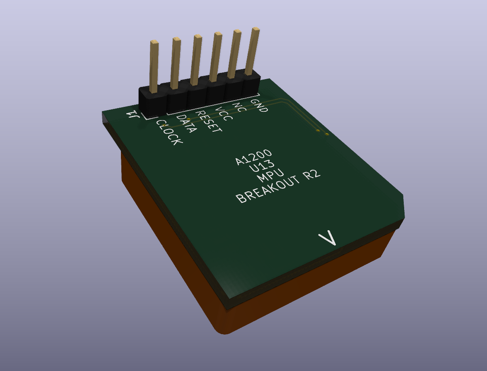

## This is a simple PLCC breakout board for A1200 U13 (CLOCK, DATA, RESET, 5V, NC, GND).

### Compatible with:
- A500 keyboard connector
- AmigaHID Pico
- any other adapter which is provide KB_CLK, KB_DAT, optionally KB_RESET

### Component clearance & compatibility:
- Headers/Sockets: Fits standard JST sockets or pin headers (straight or right-angle), no interference with the keyboard connector on the A1200 PCB.
- Indivision AGA MK3: Fully compatible—no mechanical interference between PCBs.
